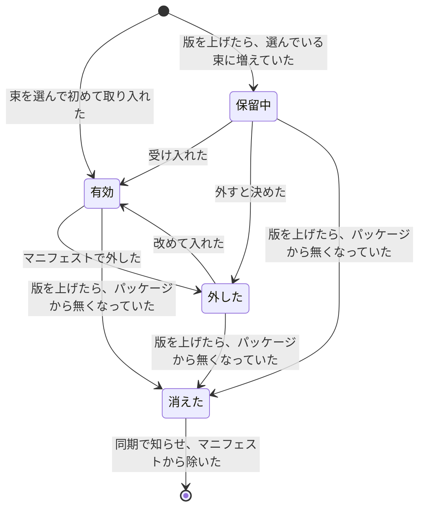

# quality-rules: 選んで取り入れるコードの決まりのパッケージ

> 公開リポジトリ `reeschan/quality-rules` に置く前提の仕様。言葉はリポジトリのルートの `GLOSSARY.md` に従う。

## Problem Statement

あるプロジェクトで、lint のルール（oxlint の独自ルール・組み込みルールの上限・biome・knip・依存の向きの検査・重複の検査）と、読んで守る規約（名前・関心ごと・コメント・テストなど）を積み上げ、エージェントの書くコードの質を保てるようになった。けれども、それはそのプロジェクトの中にしか無く、別のプロジェクトで同じ質を求めるには、毎回思い出して手で写すしかない。手で写すと、元のプロジェクトのコードや業務の文脈まで持ち出してしまう恐れがあり、直したルールも各プロジェクトには届かない。

プロジェクトによって言語もフレームワークも違い、合わないルールもある。全部を一律に入れるのではなく、プロジェクトごとに選んで取り入れたい。

## Solution

コードの決まりを、**層**（共通・言語・フレームワーク）ごとの**束**にまとめたパッケージを、公開リポジトリから配る。

- プロジェクトは**マニフェスト**に、取り入れる**束**と、外す**ルール**・**規約**と、オプションを書く。
- パッケージの CLI が、**マニフェスト**から各道具の設定の**生成物**を作る。プロジェクトの設定はそれを `extends` し、**案件固有**の決まりはその後ろに書く。
- **規約**の本文はパッケージに置き、プロジェクトは選んだ ID だけを持つ。レビュー（lens-review）は**マニフェスト**を読んで、選ばれた**規約**を観点に足す。
- 新しいプロジェクトでも既存のプロジェクトでも、stack-setup スキルから束を選んで入れられる。
- パッケージの版を上げても、増えた**ルール**は**保留中のルール**として知らされるだけで、受け入れるまで有効にならない。
- 最初に対応するのは 共通 + TypeScript + React。Python などは、層の形だけを用意して後で足す。

### 状態の図: プロジェクトの中の、ルール・規約 1 本の一生



## User Stories

1. プロジェクトを始める開発者として、stack-setup で言語とフレームワークを答えると、合う束の一覧が出てほしい。自分で全部のルールを調べなくて済むから。
2. 開発者として、束の中のルールと規約を 1 本ずつ見て、合わないものだけを外したい。束ごと捨てずに済むから。
3. 開発者として、選んだ結果が 1 つのマニフェストに残ってほしい。あとで何を入れて何を外したかが分かるから。
4. 既存のプロジェクトの開発者として、`/stack-setup rules` でルールだけを入れたい。道具の組み直しまではしたくないから。
5. 開発者として、`sync` を走らせると biome・oxlint・knip・依存の向きの検査の設定の生成物ができてほしい。各道具の設定の書き方を覚えなくて済むから。
6. 開発者として、プロジェクトの設定は生成物を `extends` するだけで済み、案件固有のルールはその後ろに足せてほしい。共通の部分と自分の部分を分けて読めるから。
7. 開発者として、生成物を手で直してしまったとき、`check` が CI で落ちてほしい。直した内容が次の `sync` で黙って消えないから。
8. 開発者として、パッケージの版を上げたとき、増えたルールと消えたルールの一覧が出てほしい。何が変わったかを知ってから受け入れたいから。
9. 開発者として、増えたルールを 1 本ずつ、またはまとめて受け入れたい。受け入れるまでは、今までどおり lint が通ってほしい。
10. 開発者として、ルールのオプション（許すファイル・許す関数名・上限の値・基準のブランチ・対象のフォルダ）をマニフェストに書きたい。プロジェクトの構成に合わせられるから。
11. 開発者として、引数の数や関数の行数の上限を、束の既定値から変えたい。古いコードを段階的に直す間だけ緩めたいことがあるから。
12. 開発者として、lint の抑止コメントで逃げられないようにしたい。例外は設定ファイルに理由付きで書かせたいから。
13. 開発者として、関数の呼び出しに真偽値のリテラルを渡すのを止めたい。呼び出し側で意味が読めなくなるから。
14. 開発者として、指数表記の小さな数値（許容差など）を、決めたファイルの外に書けないようにしたい。同じ意味の値が散らばらないから。
15. 開発者として、2 つの範囲の最小・最大を比べる手書きの判定を、決めたファイルの外に書けないようにしたい。範囲の判定を共通の関数に集めたいから。
16. React を使う開発者として、コンポーネントの props を分割代入しない決まりを選んで入れたい。
17. 開発者として、層の順・閉じたモジュール・循環の禁止を、層の定義をマニフェストに書くだけで検査したい。
18. 開発者として、基準のブランチとの差分にかかる重複だけを検査したい。古い重複で CI が落ちないから。
19. 開発者として、決めたフォルダの全ファイルが単体テストから読まれているかを検査したい。純粋な計算にテストが付いていることを保ちたいから。
20. レビューを頼む開発者として、lens-review がマニフェストで選んだ規約を観点に使ってほしい。プロジェクトごとの決まりでレビューされるから。
21. レビューを頼む開発者として、lint で検査済みの部分は、レビューで同じ指摘を重ねて出してほしくない。
22. レビューを頼む開発者として、受け持つルールを外した規約は、レビューで全部を見てほしい。機械の検査が無くなった分を補うから。
23. 開発者として、規約を外したら、それを受け持つルールも一緒に外れてほしい。片方だけ残って食い違わないように。
24. 開発者として、案件固有の規約に別の接頭辞を付けたい。パッケージの規約の ID と重なったら `sync` に止めてほしい。
25. 規約を読む人として、規約ごとに 理由・悪い例・良い例・確かめる問い・機械検査・機械では拾えない残り が揃っていてほしい。
26. Python など別の言語のプロジェクトの開発者として、将来その言語のパッケージが出たとき、共通の規約を同じ本文で受け取り、例のコードは自分の言語で読みたい。
27. stack-setup の利用者として、TypeScript の道具の組を `biome + oxlint`（既定）か `ESLint + Prettier` から選びたい。独自ルールはどちらでも動いてほしい。
28. stack-setup の利用者として、選んだ束と外した ID をテンプレートに保存し、次のプロジェクトで使い回したい。
29. パッケージの保守者として、各独自ルールに、引っかかる例と引っかからない例を見本として置き、CI で確かめたい。
30. パッケージの保守者として、ルールを足すのは minor、既定を厳しくするのは major、直すだけなら patch として版を出したい。利用者が版の番号から影響を読めるから。
31. パッケージの保守者として、GitHub Actions から provenance 付きで npm に公開したい。
32. パッケージの保守者として、公開リポジトリに、元にしたプロジェクトのコード・パス・業務の語が入らないようにしたい。
33. 英語の利用者として、README の入口とルールの ID・lint のメッセージは英語で読みたい。

## Implementation Decisions

### リポジトリとパッケージ

- リポジトリは `reeschan/quality-rules`（公開、MIT）。pnpm workspace の monorepo。
- パッケージは 3 つ。
  - `rules`: 共通の層の**規約**の本文。言語に依らない説明だけを持ち、例のコードは持たない。単独では公開せず、言語のパッケージに同梱する。
  - `typescript`（公開名 `@reeschan/quality-rules-typescript`）: TypeScript の層の束。biome・oxlint・knip・dependency-cruiser の preset、独自の oxlint ルール、検査スクリプト、TS の層の**規約**の本文、共通の**規約**への TS の例、CLI。
  - `react`（公開名 `@reeschan/quality-rules-react`）: React の層の束。preset の差分、独自ルール、規約の本文と例。
- npm の公開スコープは `@reeschan/`。公開は GitHub Actions から provenance 付き。npm のアカウント・スコープ・公開用の secret は、保守者が用意する。

### 束とルール・規約

- **規約**は 1 項目 1 ファイル。持つ欄: ID・層・束・理由・悪い例・良い例（言語のパッケージが言語ごとに持つ）・確かめる問い・機械検査（受け持つ**ルール**の名前、無ければ無し）・機械では拾えない残り。
- **規約**と、それを受け持つ**ルール**は同じ**束**に入る。
- 規約の ID は分類名＋番号（NAME・GEN・FIX・REUSE・CONCERN・TYPE・CMT・UX・E2E・UNIT・STYLE）。番号はこのリポジトリで新しく振る。
- 独自の oxlint ルールの接頭辞は `quality-rules/`。名前は `no-…` / `prefer-…` の形で、コードの見た目で名付ける。ESLint と同じ書き方で書き、ESLint でも動かす。
- 本文は日本語、ID・README の入口・lint のメッセージは英語。

### マニフェスト

プロジェクトのルートの `quality-rules.json`。形（決定の要所だけ）:

```jsonc
{
  "packages": { "@reeschan/quality-rules-typescript": "1.2.0", "@reeschan/quality-rules-react": "1.0.0" },
  "packs": ["size-limits", "lint-hygiene", "concern", "comments", "react"],
  "exclude": ["CMT-7", "quality-rules/no-boolean-argument"],
  "include": [],                       // 外した規約の、受け持つルールだけを改めて入れるとき
  "options": { "quality-rules/no-scientific-literal": { "allowFiles": ["…"] }, "max-params": 5 },
  "resolved": ["NAME-1", "…", "quality-rules/no-disable-comments", "…"]  // 有効なものの一覧（同期が書く）
}
```

- `resolved` は**同期**が書く。版を上げたとき、束にあって `resolved` にも `exclude` にも無いものが**保留中のルール**になる。
- 案件固有の規約の ID は、パッケージの分類名と重ならない接頭辞（例 `PROJ-`）を使う。`sync` は重なりを見つけたらエラーで止める。

### CLI（`quality-rules`）

- `list`: 束・ルール・規約の一覧と説明を出す（stack-setup が選択肢に使う）。
- `sync`: マニフェストとパッケージの版から**生成物**を作り直す。保留中・消えたものを一覧で出す。`--accept <id>` / `--accept-all` で保留中を受け入れ、`resolved` に足す。消えたものは `resolved` と `exclude` から除き、除いたことを出す。
- `check`: 生成物がマニフェストと今の版から作るものと一致するかを検査し、違えば失敗する（CI 用）。保留中があれば知らせるが、失敗にはしない。
- 生成物はプロジェクトの `quality-rules/` フォルダに置く。biome・oxlint はプロジェクトの設定から `extends`、knip は設定を JS にして読み込む、dependency-cruiser は生成した設定を読み込む。
- 生成物は CLI だけが書く。プロジェクトの設定ファイルは CLI が書き換えない（初回だけ、`extends` の行を足す案内を出す）。

### 実装の計画で決めたこと（2026-11-20、保守者が承認）

- **束の割り当て**: 規約は、受け持つルールの束に入れる（ルール側に合わせる）。作業メモの規約（CMT）・パス別名と三項演算子の規約（STYLE）→ `lint-hygiene`、公開する口の規約（CONCERN）→ `structure`、UNIT → `unit-tests`、真偽値の引数の規約（NAME）→ `no-boolean-argument` と同じ束。受け持つルールの無い規約は分類ごとの束（`naming`・`generality`・`root-cause`・`reuse`・`concern`・`comments`・`ux`・`e2e`・`types`）。`no-scientific-literal`・`no-range-bound-comparison` は束 `centralize`、biome の基本の設定と書式は束 `baseline`、knip は束 `unused-code`。上のマニフェストの例の束の名前は例にすぎない。
- **束の形**: ルールは `packs/<束>.json` に、規約は規約のファイルの「束」の欄に書き、束の中身を両者の和とする（規約だけの束は packs のファイルを持たない）。
- **版上げと同時に新しい束を選んだとき**: 各ルール・規約に、パッケージに足された版を持たせる。マニフェストの `packages` に書いた（前回同期した）版より新しく足されたもので、前回も選んでいた束にあるものだけを保留中にする。初めて選んだ束のものは有効にする。
- **案件固有の規約**: マニフェストに `"local": { "prefix": "PROJ", "dir": "docs/conventions" }` の欄を足す。`sync` は、prefix がパッケージの分類名と重なるとき、または dir の規約のファイルの ID がパッケージの規約の ID と重なるとき、エラーで止める。
- **道具の組**: マニフェストに `"toolchain": "biome-oxlint" | "eslint-prettier"`（既定は `biome-oxlint`）を足す。`eslint-prettier` なら、`sync` は biome・oxlint の代わりに ESLint の flat config と Prettier の設定の生成物を作る。
- **重複と単体テストの検査**: CLI の下位コマンド `quality-rules duplication` / `quality-rules unit-tests` にする。`check` はこれらを走らせない（`check` は生成物の一致だけを見る）。
- **`quality-rules/` の知らないファイル**: `sync` は消さずに残し、知らせる。
- **Python などの層**: 文書（層の足し方の手引き）と、カタログの形が言語に依らないことに留め、パッケージの雛形は作らない。
- **公開**: changesets で版を上げ、`v*` のタグの push（と手動の起動）で公開の workflow が走る。タグを打つのは保守者。
- **ルートの scripts**: `install`・`typecheck`・`lint`・`test`・`build`・`check:example`。

### lens-review への手当て（lens-review のリポジトリで PR）

- 規約を集める手順に、「ルートに `quality-rules.json` があれば、`resolved` のうち規約の ID に当たるファイルを、インストール済みのパッケージから探し、`--rules` と同じに扱う」を足す。
- 規約に「機械検査」があり、そのルールが `resolved` にあれば、その規約は「機械では拾えない残り」だけを見る。ルールが外れていれば規約の全部を見る。
- マニフェストの形は、この仕様のものを読むだけにする。

### stack-setup の拡張（スキルの新しい版）

- TypeScript の問いに「道具の組」を足す。`biome + oxlint`（既定）か `ESLint + Prettier`。
- 手順 3（追加の構成）の後に「ルールの束を選ぶ」を足す。選択肢は `quality-rules list` から取る。選んだらマニフェストを書き、`sync` を呼ぶ。
- `/stack-setup rules`: 既存のプロジェクト向け。マニフェストが無ければ作り、あれば `sync` の差分を見せて受け入れを聞く。
- テンプレートに「選んだ束・外した ID」の欄を足す。

### 書き起こしの依頼文（公開リポジトリに持ち込む内容のすべて）

元にしたプロジェクトのコードは写さない。下の一般化した説明だけを使い、実装・テスト・例を新しく書く。書く作業は、元のプロジェクトを読めない作業フォルダ（このリポジトリ）で行う。

#### TypeScript の層: 独自ルール

| ルール | 禁じること | オプション |
| --- | --- | --- |
| `quality-rules/no-disable-comments` | lint の抑止コメント（eslint・oxlint・biome の disable / ignore） | なし（例外は設定ファイルの overrides に理由付きで書かせる） |
| `quality-rules/no-boolean-argument` | 関数の呼び出しの引数に真偽値のリテラルを渡すこと | 許す関数名、許す名前のパターン（例 `^set[A-Z]`） |
| `quality-rules/no-scientific-literal` | 指数表記の数値リテラルを、許したファイルの外に書くこと | 許すファイル |
| `quality-rules/no-range-bound-comparison` | 2 つの範囲の最小（`min`）と最大（`max`）を比べる式を、許したファイルの外に書くこと | 許すファイル |

#### TypeScript の層: 組み込みルールと preset

- 大きさの上限（束 `size-limits`）: 関数の行数 100（空行・コメントを除く）、ファイルの行数 400、引数 4、ネストの深さ 4。値はオプションで変えられる。
- 書き方（束 `lint-hygiene`）: 三項演算子を禁止、`todo`・`fixme`・`xxx`・`hack` の作業メモのコメントを禁止、親フォルダへの相対 import を禁止（パス別名を使わせる）、抑止コメントの禁止。
- biome: 推奨の preset を出発点に、書き起こし側で選び直す。console 出力・`any`・`==`・入れ子の三項演算子・引数への再代入・配列の添字を key にすることなどを止め、書式はシングルクォート・幅 100・末尾カンマ es5。
- knip: 最小の preset。entry と ignore はプロジェクトが書く。
- 依存の向き（束 `structure`）: 層の順（上の層から下の層へだけ import してよい）、閉じたモジュール（公開ファイル以外の中身を外から import しない）、循環の禁止、純粋な計算の層に UI ライブラリを入れない。層の名前・フォルダ・順・閉じたモジュールはマニフェストのオプションで受ける。
- 変更行の重複（束 `duplication`）: 基準のブランチとの merge-base からの変更行にかかる重複だけを jscpd で検出する。基準のブランチは、手元のブランチより先にリモートの追跡ブランチを見る。基準のブランチと対象のフォルダはオプション。
- フォルダの単体テスト（束 `unit-tests`）: 決めたフォルダの全ファイルが、単体テストのどれかから import されているかを検査する。フォルダとテストの置き場はオプション。

#### React の層

- `quality-rules/no-props-destructuring`: コンポーネントの引数で props を分割代入すること（`props.xxx` で参照させる）。
- biome の a11y と JSX のルール（alt・button の type・key・role の正しさなど）を束 `react` に入れる。

#### 共通の層: 規約（一般化した 1 行ずつ）

- 名前（NAME）: 名前を読めば返すものと副作用が分かる / 真偽値の引数を避け、意味の分かる名前の関数に分ける（機械検査あり）/ 実体と合う言葉を使う / 状態の名前は対象を正しく言う / 通常と違う扱いは例外だと分かる名前にし、値は対象でなく振る舞いで名付ける
- 用途に縛らない（GEN）: 呼び出し元の画面の名前でなく役割で名付けて共通の場所に置く / 特定の値を名前や本体に埋め込まず引数で受ける
- 原因を直す（FIX）: 症状を後付けの処理で抑えず原因を直す / 同じ補正の呼び出しが増えるなら値を決める場所を見直す
- 共通化（REUSE）: 新しい関数・部品を作る前に同じ役割のものを探す / 条件が重なって読みにくい式は意味の分かる名前の小さな関数に切り出す
- 関心ごと（CONCERN）: 状態を持つのは 1 か所 / 順の段取りは 1 か所 / 判断は純粋な関数に / 1 つの関数・モジュールに 1 つの役割 / 公開する口は公開ファイルだけ（機械検査あり: 依存の向き）/ 受け手は判断を持たない
- コメント（CMT）: 処理の振る舞いだけを書き使う側の事情を書かない / 事実と合わないことを書かない / 作業メモ（TODO・経緯・議論・確認待ち）をコードに残さない（機械検査あり）/ 同じ説明を層ごとに書かず定義の 1 か所に書く / ほかの名前を並べずふるまいを言葉で書く / コードの言い直しでなく前提・制約・外から見える約束を書く / 説明を書く関数には引数ごとと戻り値の説明を書く
- 判断の相談（UX）: 仕様で決まっていない UX の判断は実装の前に止めて聞く / 原文に無い分岐を決めたら仮決めとして出どころを残す / 1 回の操作で、操作の名前に無い変化を一度に起こさない
- E2E: E2E には画面の操作の流れの代表だけを書き、規則の組み合わせは単体テストで確かめる / E2E の確かめは利用者に見える結果に対して行い、中身に縛らない

#### TypeScript の層: 規約

- 型（TYPE）: 共有する型は決めた 1 か所に寄せる（場所はオプション）/ 種類を表す文字列は直書きせず `as const` のオブジェクトと同名の型にする
- 単体テスト（UNIT）: 決めたフォルダに純粋な計算を足したら、同じ変更で単体テストを足す（機械検査あり）
- 書き方（STYLE）: パス別名を使う（別名はオプション、機械検査あり）/ 三項演算子を使わない（機械検査あり）

#### React の層: 規約

- STYLE: props は分割代入せず `props.xxx` で参照する（機械検査あり）

## Testing Decisions

- よいテストは、外から見える振る舞いだけを確かめる。関数を直接呼んで中の値を見ない。
- 合意済みの seam:
  1. **CLI**（`quality-rules` の `sync` / `check` / `list`）: 一時フォルダに見本のプロジェクト（マニフェストとプロジェクトの設定）を作り、CLI を走らせて、生成物の中身・保留中と消えたものの知らせ・`check` の成否・ID の重なりでのエラーを確かめる。版上げは、見本のパッケージの版を 2 つ用意して確かめる。状態の図の `%% never` の 5 行は、この seam のテストに 1 本ずつ当てる。
  2. **独自ルール**: 見本のコード（引っかかる例・引っかからない例）に実際に oxlint をかけ、出た指摘の位置とメッセージを確かめる。同じ見本を ESLint にもかけ、同じ指摘が出ることを確かめる。
- lens-review の手当ては、lens-review のリポジトリの evals で、マニフェストのある見本を使って確かめる（この仕様のパッケージの範囲の外）。
- stack-setup の拡張は、別のプロジェクトに実際に入れて確かめる（手で 1 回。自動のテストは持たない）。
- パッケージの CI は、見本のプロジェクト（`examples/react-app`）で `sync` → `check` → lint を回す。

## Out of Scope

- 元にしたプロジェクトを、このパッケージに乗り換えること（別に決める）。
- TypeScript・React 以外の言語・フレームワークの束（層の形だけを用意する）。
- 規約の本文の英訳（後で足せる形にだけする）。
- 新しいレビューのスキルを作ること（lens-review を使う）。
- 規約を lens-review の観点（lenses）として足すこと。

## Further Notes

- 作業は 3 つのリポジトリにまたがる: `reeschan/quality-rules`（新しく作る）、reeschan の lens-review（PR）、stack-setup スキル（新しい版）。依存の順は、パッケージ → lens-review の手当て → stack-setup の拡張 → 別のプロジェクトでの試し。
- 状態の図は、ルールの状態と「生成物に入っているか」の 2 つに分けて TLC で検査した（pstack の `/statechart` from-chart、2026-11-20）。「保留中のルールが指摘を出す」「消えたルールが生成物に残る」の 2 つは、どの道筋でも起きないことを確かめた。検査の途中で、「受け入れて同期した」ときに生成物へ入るのは受け入れたルールだけで、外したルールまで入れてはいけない、という条件が図から抜けていたことが分かり、足した。残りの 3 つ（外したルールが勝手に戻る・規約とルールの食い違い・手で直した生成物）は状態の組では書けないので、CLI の seam のテストで確かめる。
- 公開リポジトリに出す前に、public-guard（`/public-guard:public-guard doctor`）が入っているかを確かめる。
- GitHub のリポジトリを作る・npm に公開するのは外への変更なので、そのたびに保守者の許可を取る。
